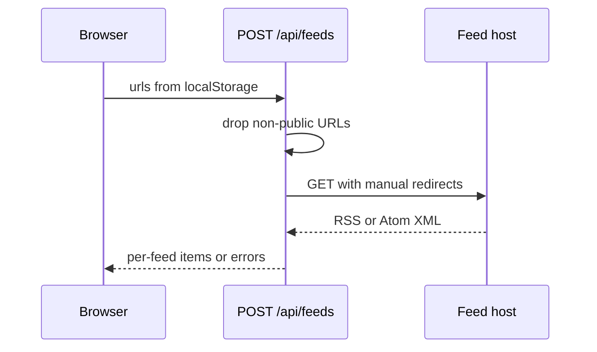

# Feed management design

## Data

A stored feed is `{ url, title }` under `localStorage` key `rss-revenant.feeds.v1`. Key `rss-revenant.seeded.v1` records that the browser has already been seeded, so an intentionally empty list stays empty. The cap is 20 feeds.

Parsed items use a stable id of `feedUrl + guid or link or title`, with a numeric suffix only when that key collides. Dates are ISO strings or null. HTML is reduced to text before it leaves the parser.

## Flow

`lib/url-guard.ts` allows only public `http` and `https` URLs. `lib/fetch-feed.ts` follows up to three redirects and checks each target. `lib/parse-feed.ts` reads RSS 2.0 (`channel.item`), Atom (`feed.entry`), and RSS 1.0 (`rdf:RDF`). `content:encoded` wins over a shorter description. Item links prefer `rel="alternate"`.

`POST /api/feeds` accepts `{ urls: string[] }` and returns `{ feeds: FeedResult[] }`. A failure is `{ ok: false, url, error }` for that URL only.

The client shell is `components/Reader.tsx` with `FeedSidebar` and `PostList`. The first client render after mount calls `loadFeeds()`. Adding a feed normalizes the URL, rejects duplicates and private hosts in the form, then refetches. Removing a feed and restoring samples both write local storage immediately.

## Errors

Network failures, non-200 responses, huge bodies, timeouts, and non-feed documents become the feed's error string. The rest of the list still renders.
